<p align="center">
  
</p>

<h1 align="center">lenslate</h1>

<p align="center">
  Play games in languages you don't read, on Linux.<br>
  lenslate reads the text on your screen and paints the translation right on top of it, on your own PC.
</p>

<p align="center">
  <a href="LICENSE"></a>
  <a href="https://github.com/malnon-labs/lenslate/releases/latest"></a>
  
</p>

<p align="center">🇬🇧 <b>English</b> · 🇨🇳 <a href="README.zh-CN.md">简体中文</a> · 🇧🇷 <a href="README.pt-BR.md">Português (Brasil)</a></p>

<p align="center">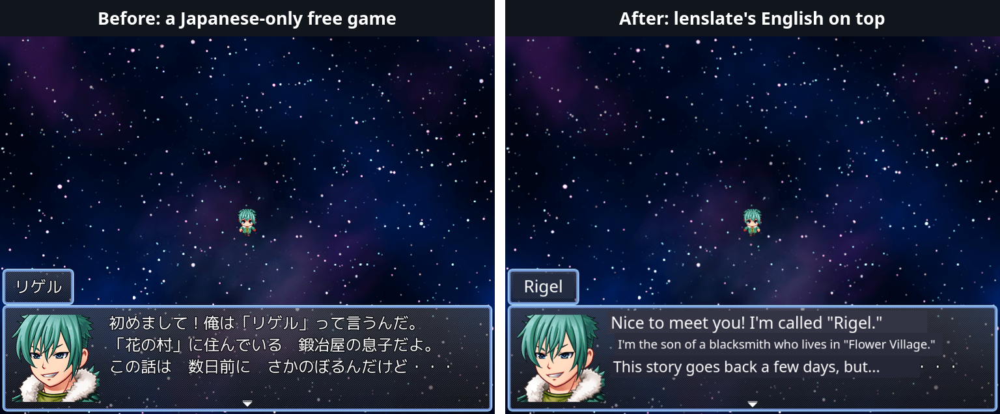</p>
<p align="center"><sub><a href="https://www.freem.ne.jp/win/game/35454">リゲルと3つの魔魂石</a> (a free Japanese-only RPG), translated on the PC by PLaMo 3 Translate.</sub></p>

lenslate is for games that aren't translated into your language: 🇯🇵 Japanese-only indie and doujin games,
🇨🇳 Chinese games, and English games for 🇧🇷 Brazilian and Portuguese-speaking players. It works on manga, comics
and screenshots too.
Draw a box around the text once and lenslate keeps it translated as you play: menus, dialogue and item
descriptions show up in your language in the same place, a bit like Google Lens but live.

**Made for Linux first.** Windows already has several tools like this. lenslate is built for Linux desktops
(KDE Plasma, X11, Hyprland, Sway…) and draws its cards above fullscreen games, also on Wayland.

- **The translation sits on the text.** No second window and no subtitle bar. Each piece of text gets a card
  with its translation, in the same place and about the same size.
- **Private, runs on your PC.** Reading and translating happen on your own computer, with no account and no
  internet needed once it is set up. Online translators (Google, DeepL and others) are there if you want them,
  as your main translator or only as a fallback, and are off until you turn them on.
- **Works without a graphics card.** Small translators run on the processor. If you have a graphics card, a
  local AI translation model gives more natural dialogue.
- **Keeps up by itself.** Auto refresh reads only what changed on screen, about once a second, and remembers
  every line it has translated, so a menu you've seen before shows up instantly.
- **Fix it once, fixed for good.** Correct a translation or a character's name and lenslate uses your version
  from then on.
- **Optional game hooks.** For Unity, RPG Maker MV/MZ and Ren'Py games, lenslate can also translate inside the
  game itself instead of over the screen.
- **Your languages:** 🇯🇵 🇨🇳 🇬🇧 🇰🇷 🇷🇺 in, 🇬🇧 🇨🇳 🇪🇸 🇧🇷 out. See [Languages](#languages).

> **Status:** early release (0.1). Everything above works, but it has only been tested on a few setups and is
> not polished yet. Expect rough edges, and please [report what goes wrong](#reporting-problems).

## Languages

<table>
  <tr><td align="center">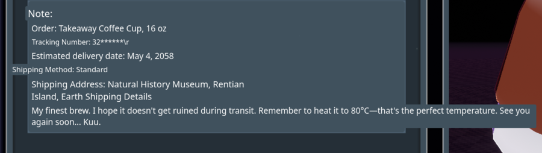<br>🇯🇵 Japanese → 🇬🇧 English<br><sub>PLaMo 3 Translate (graphics card)</sub></td></tr>
  <tr><td align="center">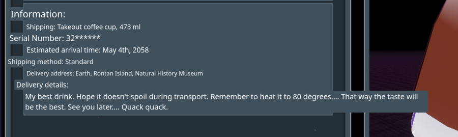<br>🇨🇳 Chinese → 🇬🇧 English<br><sub>Gemma 4 E2B (graphics card)</sub></td></tr>
  <tr><td align="center">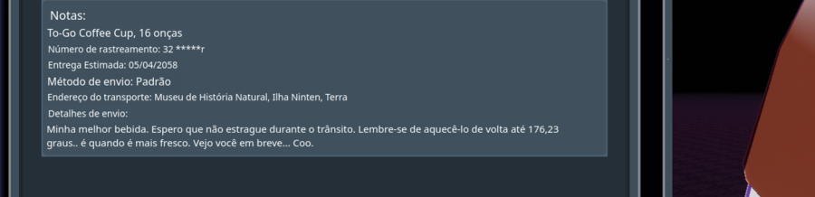<br>🇬🇧 English → 🇧🇷 Portuguese (Brazil)<br><sub>OPUS on the processor, no graphics card</sub></td></tr>
</table>

| lenslate reads | 🇯🇵 Japanese · 🇨🇳 Chinese (Simplified and Traditional) · 🇬🇧 English · 🇰🇷 Korean · 🇷🇺 Russian |
| --- | --- |
| **and translates into** | 🇬🇧 English · 🇨🇳 Chinese (Simplified) · 🇪🇸 Spanish · 🇧🇷 Portuguese (Brazil) |

- **With the AI model** on your graphics card, or an online translator, every language it reads can be
  translated into every language above. The AI models are multilingual, not one model per language pair.
- **Without a graphics card,** small processor translators cover the most common pairs: 🇯🇵→🇬🇧, 🇨🇳→🇬🇧,
  🇬🇧→🇨🇳, 🇬🇧→🇪🇸 and 🇬🇧→🇧🇷. Other pairs go through English. 🇰🇷 Korean and 🇷🇺 Russian don't have one yet
  (planned), so for now they need the AI model or an online translator.

## All kinds of text

Not only dialogue: menus, status screens, item descriptions, comics and videos with subtitles in the picture get
their cards too.

<table>
  <tr><th>Original</th><th>With lenslate</th></tr>
  <tr>
    <td align="center" valign="middle">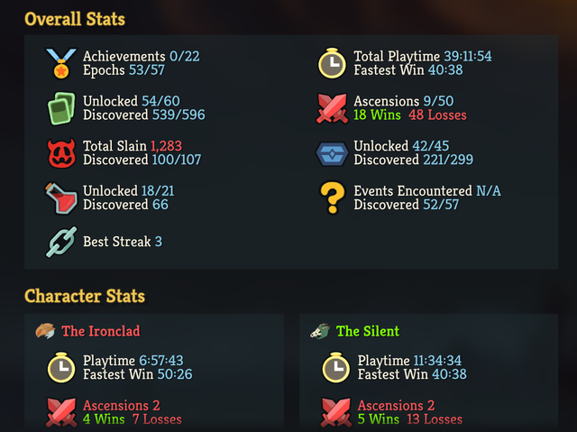</td>
    <td align="center" valign="middle">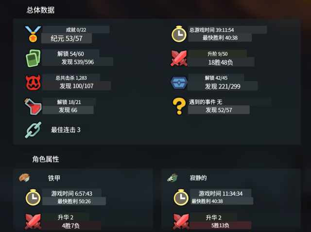</td>
  </tr>
  <tr><td colspan="2" align="center">Status screen: 🇬🇧 English → 🇨🇳 Chinese<br><sub>Gemma 4 E2B (graphics card)</sub></td></tr>
  <tr>
    <td align="center" valign="middle">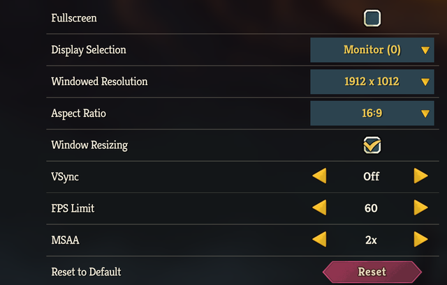</td>
    <td align="center" valign="middle">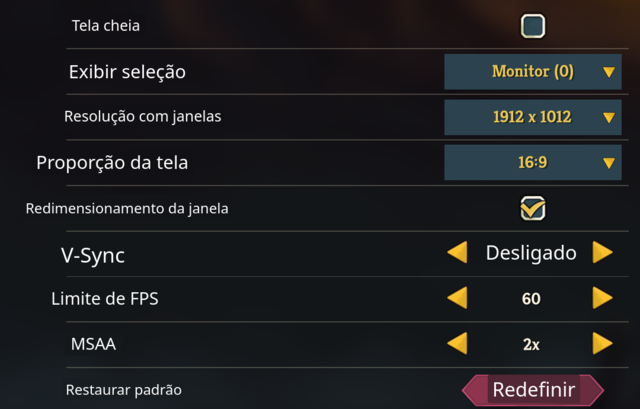</td>
  </tr>
  <tr><td colspan="2" align="center">Menu: 🇬🇧 English → 🇧🇷 Portuguese (Brazil)<br><sub>OPUS on the processor, no graphics card</sub></td></tr>
  <tr>
    <td align="center" valign="middle">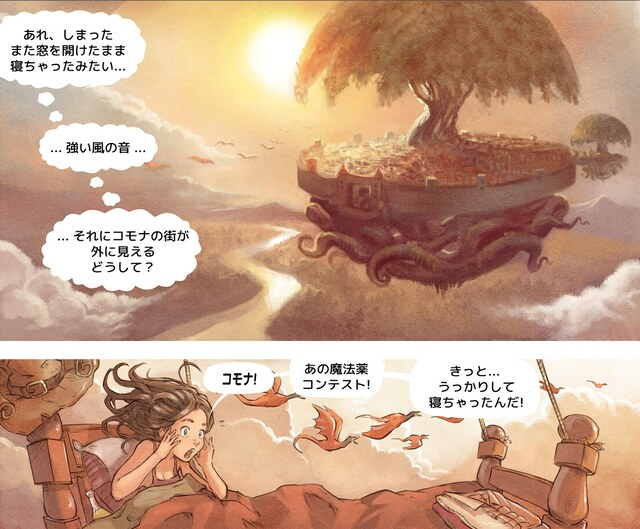</td>
    <td align="center" valign="middle">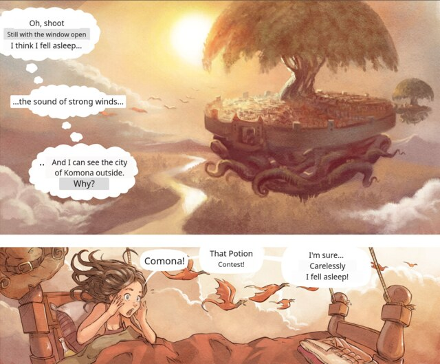</td>
  </tr>
  <tr><td colspan="2" align="center">Comic: 🇯🇵 Japanese → 🇬🇧 English<br><sub>PLaMo 3 Translate (graphics card). <a href="https://www.peppercarrot.com">Pepper&amp;Carrot</a> by David Revoy, CC-BY 4.0</sub></td></tr>
  <tr>
    <td align="center" valign="middle"></td>
    <td align="center" valign="middle">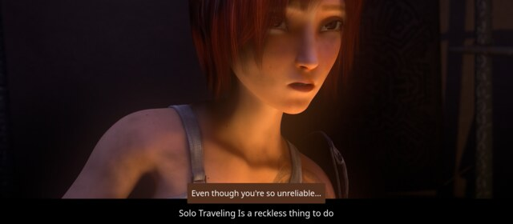</td>
  </tr>
  <tr><td colspan="2" align="center">Video, while it plays: 🇯🇵 Japanese subtitles → 🇬🇧 English, about 1 second behind<br><sub>PLaMo 3 Translate (graphics card). <a href="https://durian.blender.org">Sintel</a> © Blender Foundation, CC-BY 3.0</sub></td></tr>
</table>

## Download and install

Get `lenslate-<version>.tar.gz` from the [Releases page](https://github.com/malnon-labs/lenslate/releases/latest)
(about 6 MB), then:

```sh
tar xf lenslate-*.tar.gz && cd lenslate-*/
./install.sh
```

The installer adds what's missing from your distribution's own packages (it asks for your password only then),
puts **lenslate** in your app menu and, on KDE, sets up its keyboard shortcuts. `./install.sh --uninstall`
removes it again. Prefer git? `git clone https://github.com/malnon-labs/lenslate.git && cd lenslate && ./install.sh`.

To check the download, get the `.sha256` file from the same release and run
`sha256sum -c lenslate-*.tar.gz.sha256` in the folder that holds both.

**Coming next: AppImages.** A one-file download that needs no install, and an offline version with the reader
and the 🇯🇵→🇬🇧, 🇨🇳→🇬🇧 and 🇬🇧→🇧🇷 translators already inside.

**Will it run on my system?** lenslate is tested on **KDE Plasma 6 (Wayland)** and **X11 desktops** (Linux Mint
22 Cinnamon). The installer knows Fedora, Arch, Debian 13+, Ubuntu 25.04+, openSUSE and Linux Mint 22. Other
Wayland desktops (Hyprland, Sway, niri) should work and are only partly tested; GNOME on Wayland can't show the
overlay yet. What works where: [docs/CAPTURE.md](docs/CAPTURE.md).

## Your first translation

1. Start **lenslate** from your app menu. The first time, a setup window asks which languages you read and
   which one you want, suggests a preset for your PC, and shows every download with its size before anything
   is fetched.
2. Open your game, then click **Pick area…** in lenslate's window (or in its tray icon's menu) and drag a box
   around the text you want translated.
3. The translation appears on top. Tick **Keep translating automatically** to keep it updating as you play,
   and use **Show / hide** to hide it.

<sub>The same four actions also have keyboard shortcuts for use inside a game (Ctrl+Alt+Z, X, C and V). They
are set up for you on KDE; for other desktops see [hotkeys in the full guide](docs/USAGE.md#hotkeys-and-commands).</sub>

## A look around

<table>
  <tr>
    <td align="center">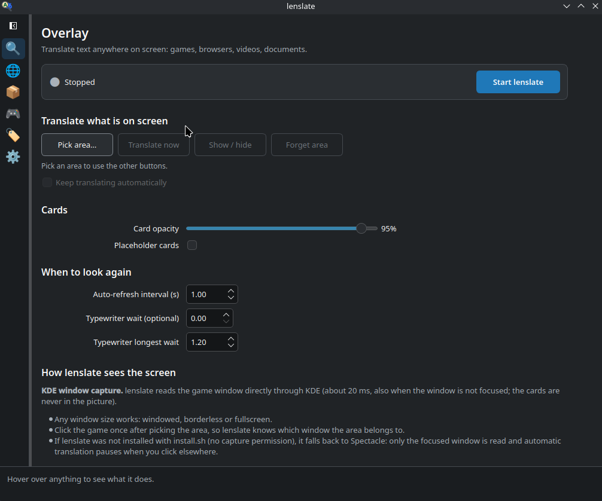<br>Pick an area, translate, show or hide: all buttons</td>
    <td align="center">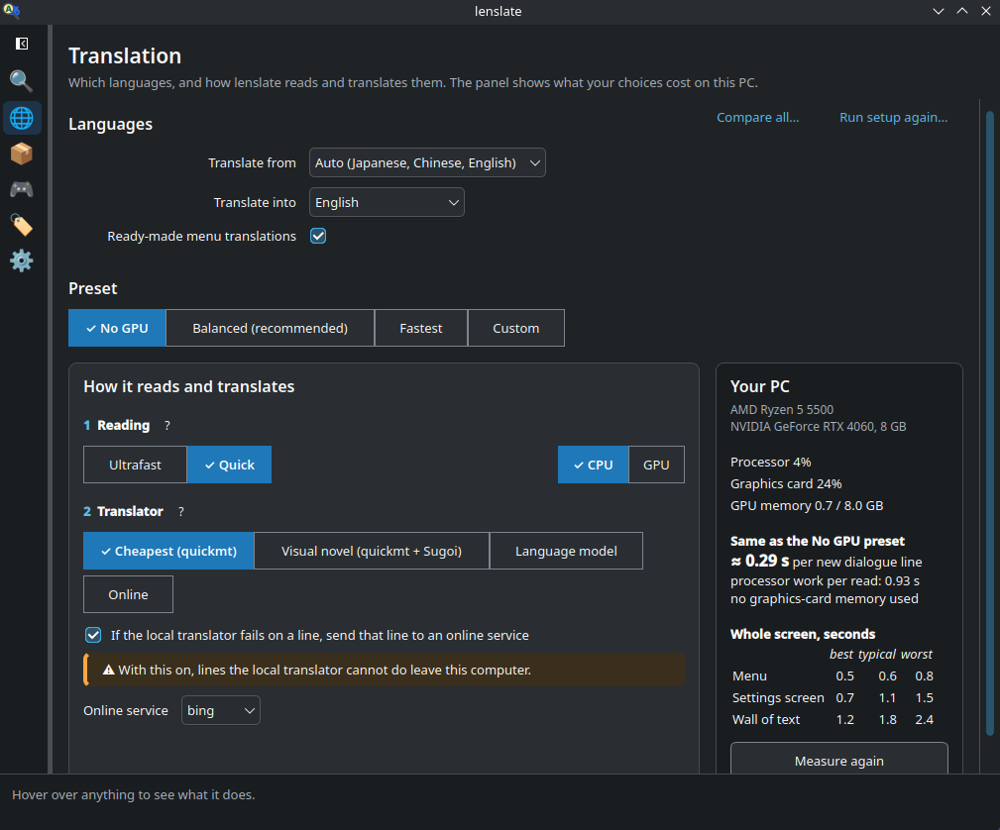<br>Presets for PCs with and without a graphics card</td>
  </tr>
  <tr>
    <td align="center">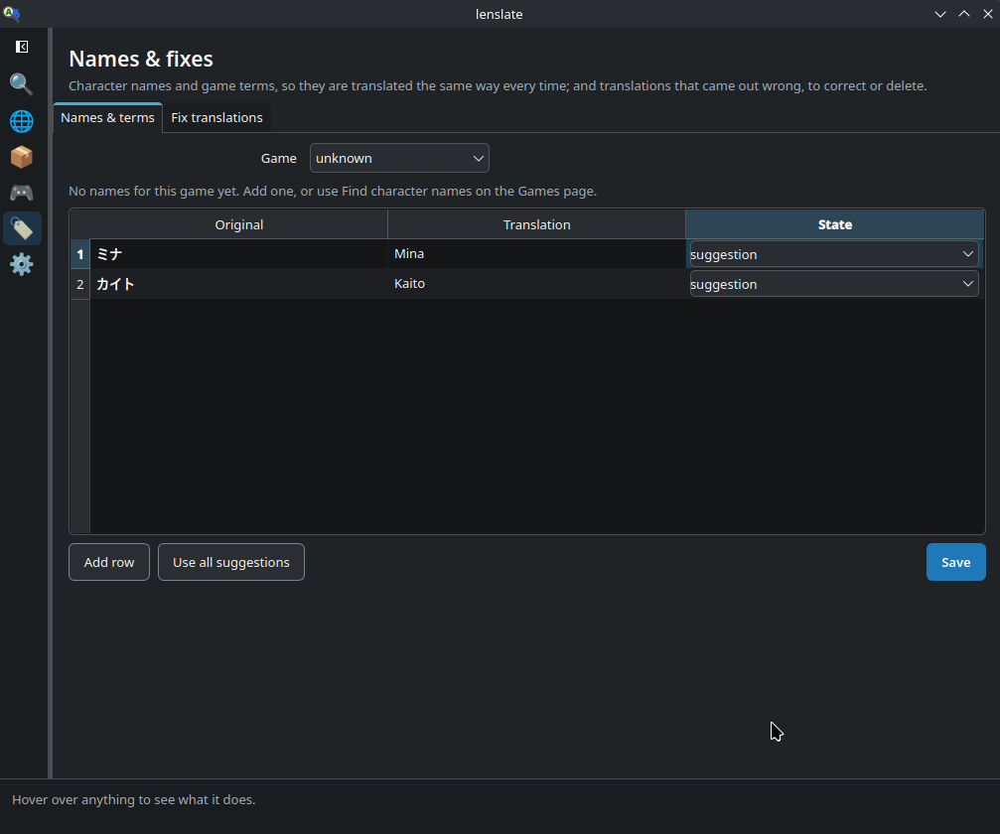<br>Character names, translated the same way every time</td>
    <td align="center">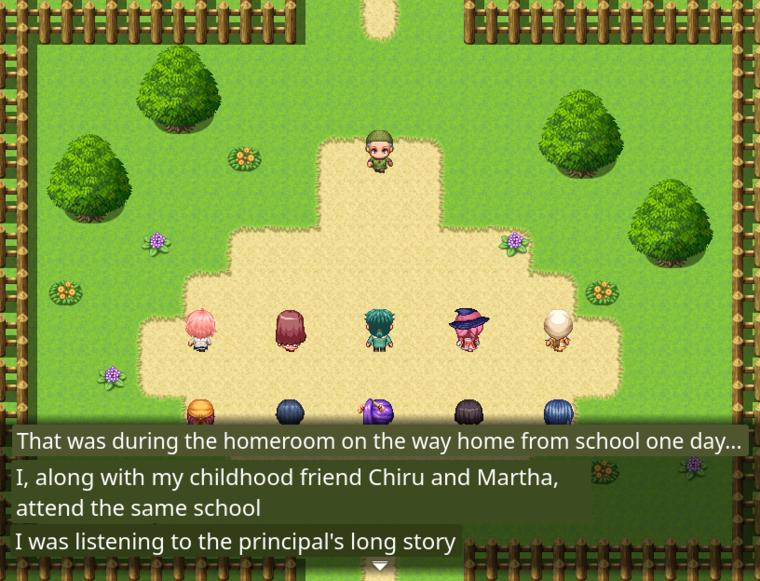<br>Story text over the map, translated in place</td>
  </tr>
</table>

The full list of features is in [docs/FEATURES.md](docs/FEATURES.md).

<sub>Game names and art in the screenshots belong to their owners and are shown only to illustrate lenslate:
Risk of Rain 2 (Hopoo Games / Gearbox), Slay the Spire 2 (Mega Crit) and <a href="https://www.freem.ne.jp/win/game/35454">リゲルと3つの魔魂石</a>
(by Chie), whose terms allow screenshots for introducing the game.
Comics: Pepper&amp;Carrot by David Revoy (CC-BY 4.0). Film: Sintel © Blender Foundation (CC-BY 3.0).</sub>

## lenslate or a game-file translator?

Tools like [RuneTranslate](https://runetranslate.itch.io/runetranslate) or Translator++ translate a game by
editing its files: the translation is done once, before you play. When your game's engine is supported, that is
the smoother experience, because nothing extra runs while you play.

lenslate doesn't touch the game at all. Use it when the engine isn't supported, when you can't or don't want to
change the game's files, or for things that aren't games. The price is that reading and translating run while
you play, on your processor or graphics card.

lenslate can also work the other way for a few engines: its optional **game hooks** translate *inside* the game
for **Unity** (through XUnity.AutoTranslator), **RPG Maker MV / MZ** and **Ren'Py 7 / 8**. RPG Maker games can
even be translated ahead of time, so nothing runs while you play. The hooks back up every file they change, and
`lenslate hook remove` puts them back. See [Game hooks](docs/USAGE.md#hooks-translation-inside-the-game-no-screen-reading).

## Good to know

- **The first start downloads.** The reading models and translators are fetched once (about 1 GB for one
  language pair).
- **Decorative lettering** (logos, glowing or outlined titles) is often misread. Normal menu and dialogue text
  reads well.
- **Some AI models are for personal use only.** PLaMo and Sugoi are free for personal and non-commercial use;
  lenslate always says which licence a model has before downloading it. All licences: [NOTICE.md](NOTICE.md).
- **Planned:** lenslate's own windows in 🇧🇷 Portuguese, 🇨🇳 Chinese, 🇯🇵 Japanese, 🇰🇷 Korean and 🇷🇺 Russian; processor
  translators for Korean and Russian; a redesigned settings window; translating pictures straight from the
  browser.

## Reporting problems

Found a bug? [Open an issue](https://github.com/malnon-labs/lenslate/issues/new/choose) and tell us your Linux
distribution and desktop, the lenslate version (`lenslate --version`), and what you saw. A debug recording helps
the most: [how to make one](docs/USAGE.md#troubleshooting--contributing). It contains screenshots of your game,
so look through it before you attach it. See [CONTRIBUTING.md](CONTRIBUTING.md) for more, and
[SECURITY.md](SECURITY.md) for security problems.

## More

- [Using lenslate](docs/USAGE.md): every command, setting, translator, preset and game hook.
- [Features](docs/FEATURES.md): everything lenslate does.
- [Privacy](docs/PRIVACY.md): what goes online and what stays on your PC. No account, no telemetry.
- [Capture on each desktop](docs/CAPTURE.md): what to share and what to expect on KDE, X11, Hyprland, Sway, GNOME.
- [Licences of what lenslate downloads](NOTICE.md).

## Licence

[GPL-3.0-or-later](LICENSE).
