<p align="center">
  
</p>

<h1 align="center">lenslate</h1>

<p align="center">
  Jogue em idiomas que você não lê, no Linux.<br>
  O lenslate lê o texto da sua tela e pinta a tradução por cima dele, no seu próprio PC.
</p>

<p align="center">
  <a href="LICENSE"></a>
  <a href="https://github.com/malnon-labs/lenslate/releases/latest"></a>
  
</p>

<p align="center">🇬🇧 <a href="README.md">English</a> · 🇨🇳 <a href="README.zh-CN.md">简体中文</a> · 🇧🇷 <b>Português (Brasil)</b></p>

<p align="center">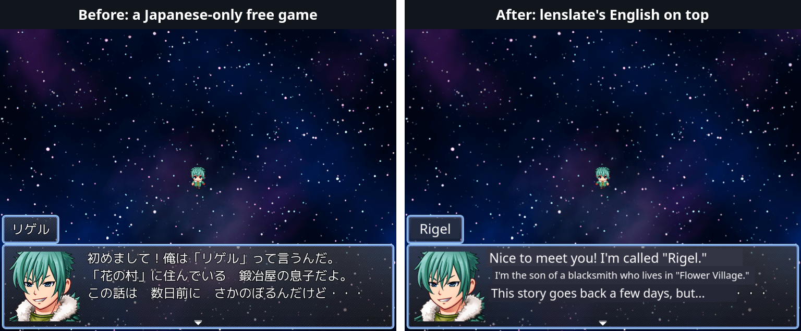</p>
<p align="center"><sub><a href="https://www.freem.ne.jp/win/game/35454">リゲルと3つの魔魂石</a> (um RPG gratuito só em japonês), traduzido no PC pelo PLaMo 3 Translate.</sub></p>

O lenslate é para jogos que não têm tradução no seu idioma: 🇯🇵 jogos indie e doujin só em japonês, 🇨🇳 jogos
chineses, e jogos em inglês para 🇧🇷 jogadores brasileiros e de língua portuguesa. Também funciona com mangás,
quadrinhos e capturas de tela.
Desenhe uma caixa em volta do texto uma vez e o lenslate mantém tudo traduzido enquanto você joga: menus,
diálogos e descrições de itens aparecem no seu idioma, no mesmo lugar, mais ou menos como o Google Lens, só que
ao vivo.

**Feito primeiro para Linux.** O Windows já tem várias ferramentas assim. O lenslate foi feito para os desktops
Linux (por enquanto KDE Plasma no Wayland e desktops X11) e desenha seus cartões por cima de jogos em tela
cheia, inclusive no Wayland.

- **A tradução fica em cima do texto.** Sem segunda janela e sem barra de legendas. Cada trecho de texto ganha um
  cartão com a tradução, no mesmo lugar e mais ou menos do mesmo tamanho.
- **Privado, roda no seu PC.** A leitura e a tradução acontecem no seu computador, sem conta e sem internet
  depois de configurado. Tradutores online (Google, DeepL e outros) estão lá se você quiser, como tradutor
  principal ou só como reserva, e ficam desligados até você ligá-los.
- **Funciona sem placa de vídeo.** Tradutores pequenos rodam no processador. Se você tem placa de vídeo, um
  modelo de IA local deixa os diálogos mais naturais.
- **Acompanha a tela sozinho.** A atualização automática lê só o que mudou, mais ou menos uma vez por segundo,
  e lembra cada linha já traduzida, então um menu que você já viu aparece na hora.
- **Corrija uma vez, vale para sempre.** Corrija uma tradução ou o nome de um personagem e o lenslate usa a sua
  versão dali em diante.
- **Ganchos de jogo opcionais.** Em jogos Unity, RPG Maker MV/MZ e Ren'Py, o lenslate também pode traduzir
  dentro do próprio jogo, em vez de por cima da tela.
- **Seus idiomas:** lê 🇯🇵 🇨🇳 🇬🇧 🇰🇷 🇷🇺, traduz para 🇬🇧 🇨🇳 🇪🇸 🇧🇷. Veja [Idiomas](#idiomas).

> **Status:** versão inicial. Foi testado só em poucas configurações e ainda não está polido. Espere algumas
> arestas e, por favor, [conte o que der errado](#relatando-problemas).

| | Onde |
| --- | --- |
| **Testado** com jogos de verdade | KDE Plasma 6 (Wayland) · X11 (Linux Mint 22 Cinnamon) · dois monitores e escala de tela de 125% |
| **Testado em parte** | niri (dentro do KDE, com uma imagem de teste) · compartilhamento de tela em outros desktops Wayland (testado só no KDE) · ganchos de jogo (pastas de jogo de teste, não jogos de verdade) · o instalador (contêineres limpos de Fedora, Debian, Ubuntu, Arch e openSUSE) |
| **Ainda não testado** | Hyprland · Sway · jogos em tela cheia exclusiva |
| **Ainda não funciona** | GNOME no Wayland (não consegue mostrar os cartões) |

## Idiomas

<table>
  <tr><td align="center">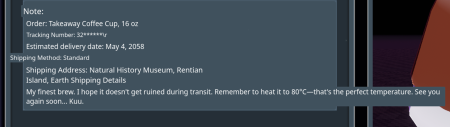<br>🇯🇵 Japonês → 🇬🇧 Inglês<br><sub>PLaMo 3 Translate (placa de vídeo)</sub></td></tr>
  <tr><td align="center">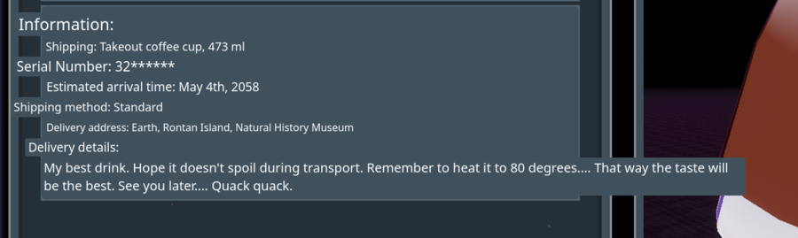<br>🇨🇳 Chinês → 🇬🇧 Inglês<br><sub>Gemma 4 E2B (placa de vídeo)</sub></td></tr>
  <tr><td align="center">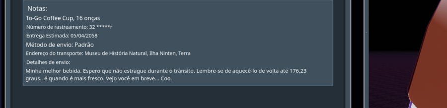<br>🇬🇧 Inglês → 🇧🇷 Português (Brasil)<br><sub>OPUS no processador, sem placa de vídeo</sub></td></tr>
</table>

| O lenslate lê | 🇯🇵 Japonês · 🇨🇳 Chinês (simplificado e tradicional) · 🇬🇧 Inglês · 🇰🇷 Coreano · 🇷🇺 Russo |
| --- | --- |
| **e traduz para** | 🇬🇧 Inglês · 🇨🇳 Chinês (simplificado) · 🇪🇸 Espanhol · 🇧🇷 Português (Brasil) |

- **Com o modelo de IA** na placa de vídeo, ou um tradutor online, cada idioma que ele lê pode ser traduzido
  para cada idioma acima. Os modelos de IA são multilíngues, não um modelo por par de idiomas.
- **Sem placa de vídeo,** tradutores pequenos no processador cobrem os pares mais comuns: 🇯🇵→🇬🇧, 🇨🇳→🇬🇧,
  🇬🇧→🇨🇳, 🇬🇧→🇪🇸, 🇬🇧→🇧🇷, 🇰🇷→🇬🇧 e 🇷🇺→🇬🇧. Os outros pares passam pelo inglês. Os de coreano e russo são
  literais e fracos com palavras soltas (os menus vêm de listas prontas); o modelo de IA traduz de forma mais natural.

## Todo tipo de texto

Não só diálogos: menus, telas de status, descrições de itens, quadrinhos e vídeos com legenda na imagem também
ganham seus cartões, todos traduzidos para 🇧🇷 português.

<table>
  <tr><th>Original</th><th>Com o lenslate</th></tr>
  <tr>
    <td align="center" valign="middle">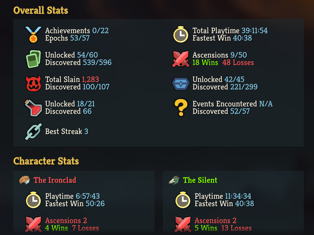</td>
    <td align="center" valign="middle">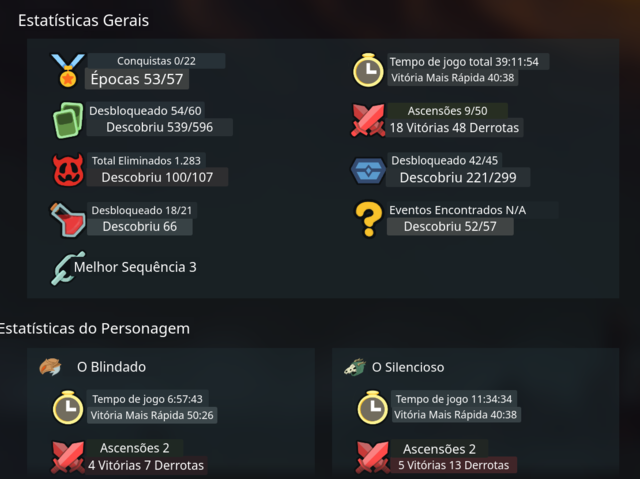</td>
  </tr>
  <tr><td colspan="2" align="center">Tela de status: 🇬🇧 Inglês → 🇧🇷 Português<br><sub>Gemma 4 E2B (placa de vídeo)</sub></td></tr>
  <tr>
    <td align="center" valign="middle">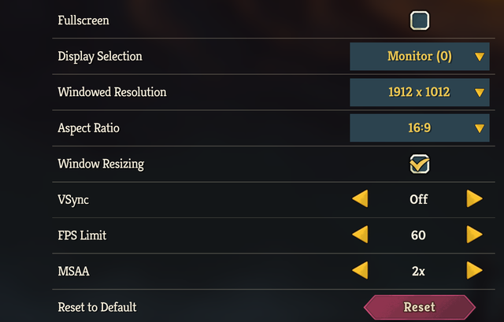</td>
    <td align="center" valign="middle">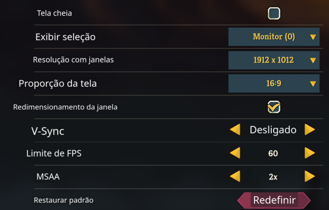</td>
  </tr>
  <tr><td colspan="2" align="center">Menu: 🇬🇧 Inglês → 🇧🇷 Português<br><sub>OPUS no processador, sem placa de vídeo</sub></td></tr>
  <tr>
    <td align="center" valign="middle">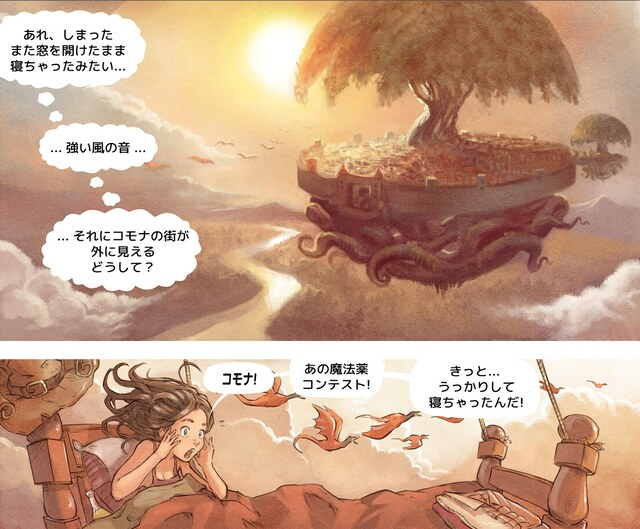</td>
    <td align="center" valign="middle">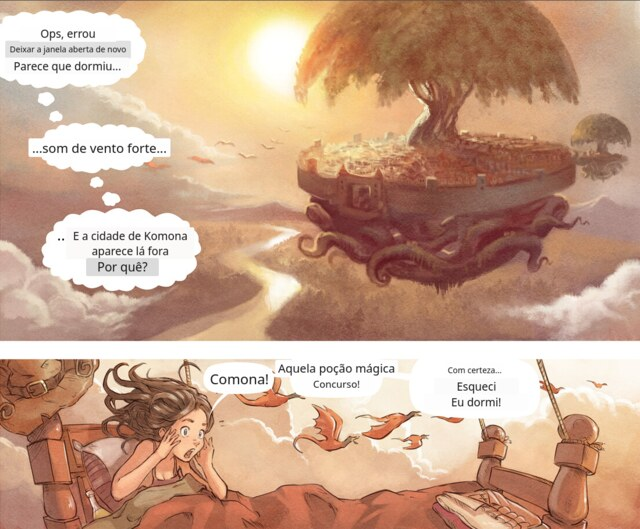</td>
  </tr>
  <tr><td colspan="2" align="center">Quadrinho: 🇯🇵 Japonês → 🇧🇷 Português<br><sub>Gemma 4 E2B (placa de vídeo). <a href="https://www.peppercarrot.com">Pepper&amp;Carrot</a> de David Revoy, CC-BY 4.0</sub></td></tr>
  <tr>
    <td align="center" valign="middle"></td>
    <td align="center" valign="middle">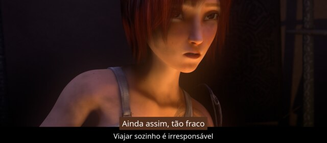</td>
  </tr>
  <tr><td colspan="2" align="center">Vídeo tocando: 🇯🇵 legendas em japonês → 🇧🇷 Português, cerca de 1 segundo depois<br><sub>Gemma 4 E2B (placa de vídeo). <a href="https://durian.blender.org">Sintel</a> © Blender Foundation, CC-BY 3.0</sub></td></tr>
</table>

## Baixar e instalar

Baixe `lenslate-<versão>.tar.gz` na [página de versões](https://github.com/malnon-labs/lenslate/releases/latest)
(uns 6 MB) e depois:

```sh
tar xf lenslate-*.tar.gz && cd lenslate-*/
./install.sh
```

O instalador adiciona o que falta pelos pacotes da sua própria distribuição (só pede sua senha nesse caso),
coloca o **lenslate** no menu de aplicativos e, no KDE, configura os atalhos de teclado. `./install.sh --uninstall`
remove tudo de novo. Prefere git? `git clone https://github.com/malnon-labs/lenslate.git && cd lenslate && ./install.sh`.

Para conferir o download, pegue o arquivo `.sha256` na mesma versão e rode
`sha256sum -c lenslate-*.tar.gz.sha256` na pasta onde estão os dois.

**Sem instalar: AppImages.** A mesma página de versões tem `lenslate-<versão>-x86_64.AppImage` (cerca de 375 MB),
um arquivo que roda sem instalar, e `lenslate-<versão>-offline-x86_64.AppImage` (cerca de 1,6 GB), que já vem com os
tradutores 🇯🇵→🇬🇧, 🇨🇳→🇬🇧 e 🇬🇧→🇧🇷, para um PC sem internet. Torne o arquivo executável
(`chmod +x lenslate-*.AppImage`) e abra; a janela de configuração oferece colocá-lo no menu de aplicativos. No KDE
Wayland o AppImage precisa dos pacotes Python Qt da sua distribuição para a sobreposição (ele diz quais quando
faltam).

**Vai rodar no meu sistema?** O lenslate foi testado no **KDE Plasma 6 (Wayland)** e em **desktops X11** (Linux
Mint 22 Cinnamon). O instalador conhece Fedora, Arch, Debian 13+, Ubuntu 25.04+, openSUSE e Linux Mint 22. O niri foi
testado em parte, Hyprland e Sway ainda não foram testados, e o GNOME no Wayland ainda não consegue mostrar a
sobreposição. O que funciona onde: [docs/CAPTURE.md](docs/CAPTURE.md) (em inglês).

## Sua primeira tradução

1. Abra o **lenslate** pelo menu de aplicativos. Na primeira vez, uma janela de configuração pergunta quais
   idiomas você lê e para qual quer traduzir, sugere uma predefinição para o seu PC e mostra cada download com
   o tamanho antes de baixar qualquer coisa.
2. Abra o jogo, clique em **Pick area…** na janela do lenslate (ou no menu do ícone da bandeja) e desenhe uma
   caixa em volta do texto que você quer traduzir.
3. A tradução aparece por cima. Marque **Keep translating automatically** para ela continuar atualizando
   enquanto você joga, e use **Show / hide** para esconder ou mostrar.

<sub>As mesmas quatro ações também têm atalhos de teclado para usar dentro do jogo (Ctrl+Alt+Z, X, C e V). No
KDE eles são configurados para você; para outros desktops veja [os atalhos no guia completo](docs/USAGE.md#hotkeys-and-commands) (em inglês).</sub>

## Uma olhada

<table>
  <tr>
    <td align="center">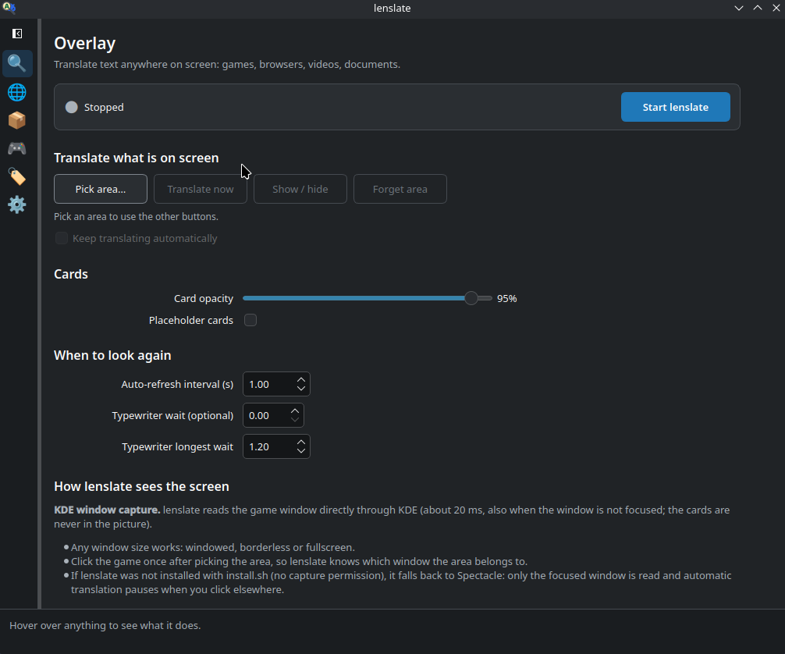<br>Escolher a área, traduzir, mostrar ou esconder: tudo com botões</td>
    <td align="center">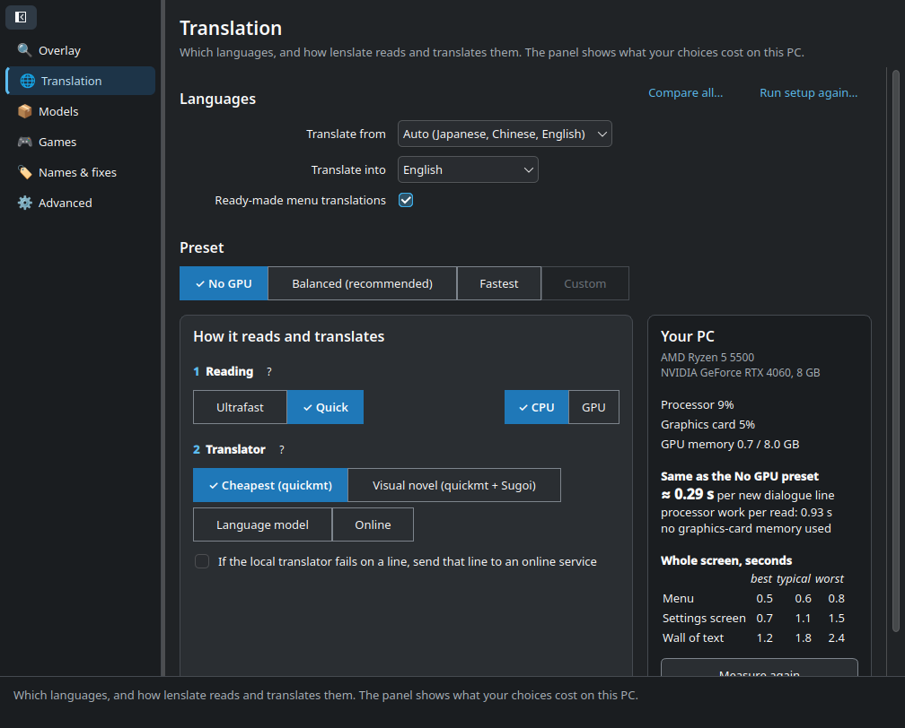<br>Predefinições para PCs com e sem placa de vídeo</td>
  </tr>
  <tr>
    <td align="center">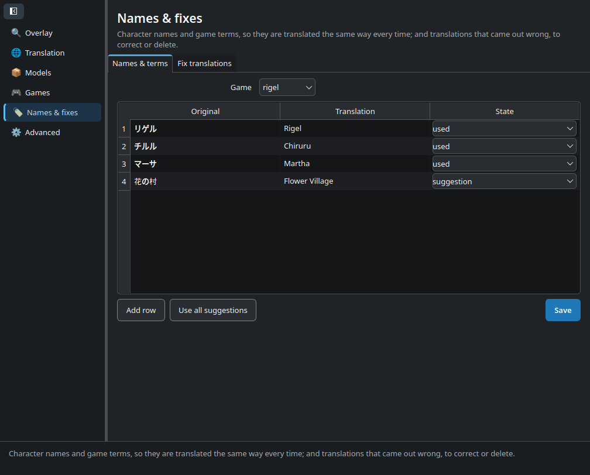<br>Nomes de personagens, traduzidos sempre do mesmo jeito</td>
    <td align="center">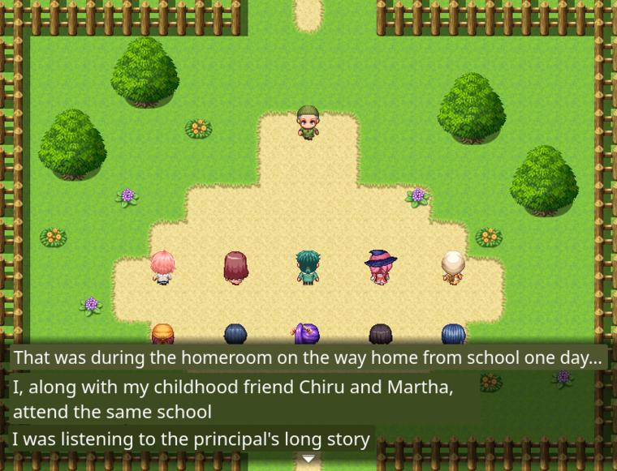<br>Texto da história sobre o mapa, traduzido no lugar</td>
  </tr>
</table>

A lista completa de recursos está em [docs/FEATURES.md](docs/FEATURES.md) (em inglês). Por enquanto as janelas
do lenslate estão só em inglês; a versão em português está planejada.

<sub>Os nomes e a arte dos jogos nas capturas pertencem aos seus donos e aparecem só para ilustrar o lenslate:
Risk of Rain 2 (Hopoo Games / Gearbox), Slay the Spire 2 (Mega Crit) e <a href="https://www.freem.ne.jp/win/game/35454">リゲルと3つの魔魂石</a>
(de Chie), cujos termos permitem capturas de tela para divulgar o jogo.
Quadrinho: Pepper&amp;Carrot de David Revoy (CC-BY 4.0). Filme: Sintel © Blender Foundation (CC-BY 3.0).</sub>

## lenslate ou um tradutor de arquivos do jogo?

Ferramentas como [RuneTranslate](https://runetranslate.itch.io/runetranslate) ou Translator++ traduzem um jogo
editando os arquivos dele: a tradução é feita uma vez, antes de jogar. Quando a engine do seu jogo é suportada,
essa é a experiência mais tranquila, porque nada a mais roda enquanto você joga.

O lenslate não mexe no jogo. Use-o quando a engine não é suportada, quando você não pode ou não quer mudar os
arquivos do jogo, ou para coisas que não são jogos. O preço é que a leitura e a tradução rodam enquanto você
joga, no processador ou na placa de vídeo.

Para algumas engines o lenslate também funciona do outro jeito: os **ganchos de jogo** opcionais traduzem
*dentro* do jogo no **Unity** (pelo XUnity.AutoTranslator), **RPG Maker MV / MZ** e **Ren'Py 7 / 8**. Jogos de
RPG Maker podem até ser traduzidos com antecedência, então nada roda enquanto você joga. Os ganchos fazem backup
de cada arquivo que alteram, e `lenslate hook remove` devolve tudo como era. Veja [Ganchos de jogo](docs/USAGE.md#hooks-translation-inside-the-game-no-screen-reading) (em inglês).

## Bom saber

- **A primeira vez baixa coisas.** Os modelos de leitura e os tradutores são baixados uma vez (cerca de 1 GB
  por par de idiomas).
- **Letras decorativas** (logos, títulos brilhantes ou com contorno) costumam ser lidas errado. Texto normal de
  menus e diálogos é lido bem.
- **Alguns modelos de IA são só para uso pessoal.** PLaMo e Sugoi são gratuitos para uso pessoal e não
  comercial; o lenslate sempre mostra a licença de um modelo antes de baixá-lo. Todas as licenças:
  [NOTICE.md](NOTICE.md) (em inglês).
- **Novo na 0.2:** as janelas do lenslate em 🇧🇷 português, 🇨🇳 chinês, 🇯🇵 japonês, 🇰🇷 coreano e 🇷🇺 russo;
  AppImages (inclusive uma offline); atalhos de teclado que você muda dentro do lenslate. **Planejado:** traduzir
  imagens direto do navegador.

## Relatando problemas

Achou um bug? [Abra uma issue](https://github.com/malnon-labs/lenslate/issues/new/choose) e diga sua distribuição
Linux e desktop, a versão do lenslate (`lenslate --version`) e o que você viu. Uma gravação de depuração ajuda
mais que tudo: [como fazer uma](docs/USAGE.md#troubleshooting--contributing) (em inglês). Ela contém capturas
do seu jogo, então dê uma olhada antes de anexar. Veja [CONTRIBUTING.md](CONTRIBUTING.md) para mais, e
[SECURITY.md](SECURITY.md) para problemas de segurança. Pode escrever em português.

## Mais (em inglês)

- [Usando o lenslate](docs/USAGE.md): todos os comandos, configurações, tradutores, predefinições e ganchos.
- [Recursos](docs/FEATURES.md): tudo o que o lenslate faz.
- [Privacidade](docs/PRIVACY.md): o que vai para a internet e o que fica no seu PC. Sem conta, sem telemetria.
- [Captura em cada desktop](docs/CAPTURE.md): o que compartilhar e o que esperar no KDE, X11, Hyprland, Sway, GNOME.
- [Licenças do que o lenslate baixa](NOTICE.md).

## Licença

[GPL-3.0-or-later](LICENSE).

<sub>Esta é uma tradução do [README.md](README.md) e pode ter frases estranhas. Falantes nativos: melhorias são
muito bem-vindas por issue ou pull request.</sub>
