<p align="center">
  
</p>

<h1 align="center">lenslate</h1>

<p align="center">
  在 Linux 上玩看不懂语言的游戏。<br>
  lenslate 读取屏幕上的文字，并把译文直接覆盖在原文上——全部在你自己的电脑上完成。
</p>

<p align="center">
  <a href="LICENSE"></a>
  <a href="https://github.com/malnon-labs/lenslate/releases/latest"></a>
  
</p>

<p align="center">🇬🇧 <a href="README.md">English</a> · 🇨🇳 <b>简体中文</b> · 🇧🇷 <a href="README.pt-BR.md">Português (Brasil)</a></p>

<p align="center">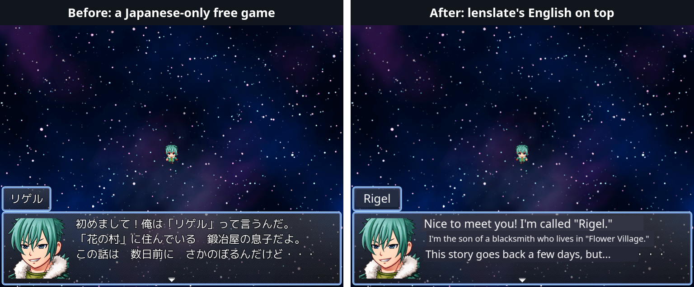</p>
<p align="center"><sub><a href="https://www.freem.ne.jp/win/game/35454">リゲルと3つの魔魂石</a>（一款只有日文的免费 RPG），由 PLaMo 3 Translate 在本机翻译。</sub></p>

lenslate 适合那些还没有你的语言版本的游戏：🇯🇵 只有日文的独立游戏和同人游戏、🇨🇳 中文游戏，以及给 🇧🇷 巴西和葡语玩家的英文游戏。
它也能用于漫画和截图。只要框选一次文字区域，lenslate 就会在你游玩时持续翻译：菜单、对话和物品说明都会以你的语言显示在原来的位置——有点像 Google Lens，但是实时的。

**Linux 优先。** Windows 上已经有不少同类工具。lenslate 是为 Linux 桌面（KDE Plasma、X11、Hyprland、Sway……）打造的，即使在 Wayland 下也能把译文卡片显示在全屏游戏之上。

- **译文就在原文上。** 没有第二个窗口，也没有字幕条。每段文字都会得到一张译文卡片，位置相同、大小相近。
- **私密，在本机运行。** 识别和翻译都在你自己的电脑上进行，无需账号，设置完成后也不需要联网。如果需要，也可以使用在线翻译（Google、DeepL 等），作为主要翻译器或仅作为备用；它们默认关闭。
- **没有显卡也能用。** 小型翻译模型在 CPU 上运行。有显卡的话，本地 AI 翻译模型能给出更自然的对话译文。
- **自动跟上画面。** 自动刷新约每秒一次，只重新识别变化的部分，并记住翻译过的每一行，看过的菜单会立即显示。
- **改一次，永远有效。** 修正一条译文或角色名后，lenslate 以后都会使用你的版本。
- **可选的游戏钩子。** 对于 Unity、RPG Maker MV/MZ 和 Ren'Py 游戏，lenslate 也可以直接在游戏内部翻译，而不是覆盖在屏幕上。
- **支持的语言：** 读取 🇯🇵 🇨🇳 🇬🇧 🇰🇷 🇷🇺，翻译成 🇬🇧 🇨🇳 🇪🇸 🇧🇷。详见[语言](#语言)。

> **状态：** 早期版本（0.1）。以上功能都能用，但只在少数环境中测试过，还不够完善。可能会遇到问题，欢迎[反馈](#反馈问题)。

## 语言

<table>
  <tr><td align="center">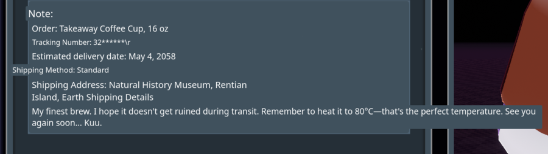<br>🇯🇵 日文 → 🇬🇧 英文<br><sub>PLaMo 3 Translate（显卡）</sub></td></tr>
  <tr><td align="center">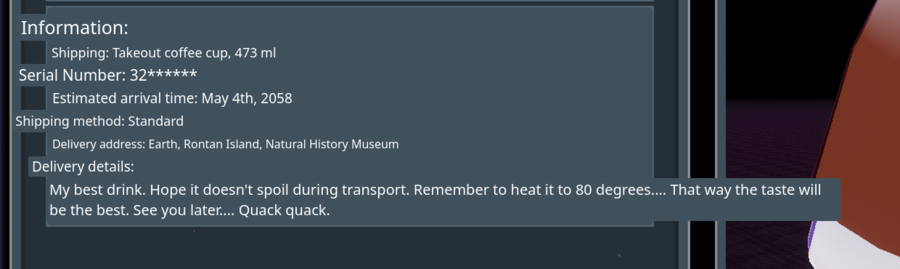<br>🇨🇳 中文 → 🇬🇧 英文<br><sub>Gemma 4 E2B（显卡）</sub></td></tr>
  <tr><td align="center">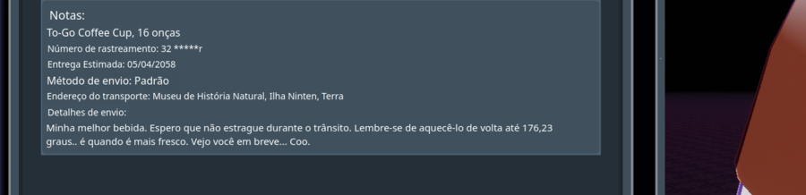<br>🇬🇧 英文 → 🇧🇷 葡萄牙文（巴西）<br><sub>OPUS，CPU 运行，无需显卡</sub></td></tr>
</table>

| lenslate 可以读取 | 🇯🇵 日文 · 🇨🇳 中文（简体和繁体）· 🇬🇧 英文 · 🇰🇷 韩文 · 🇷🇺 俄文 |
| --- | --- |
| **并翻译成** | 🇬🇧 英文 · 🇨🇳 简体中文 · 🇪🇸 西班牙文 · 🇧🇷 葡萄牙文（巴西） |

- **使用显卡上的 AI 模型或在线翻译时，** 它能读取的每种语言都可以翻译成上面的每种语言。AI 模型是多语言的，不是每个语言对一个模型。
- **没有显卡时，** 小型 CPU 翻译模型覆盖最常用的语言对：🇯🇵→🇬🇧、🇨🇳→🇬🇧、🇬🇧→🇨🇳、🇬🇧→🇪🇸、🇬🇧→🇧🇷、🇰🇷→🇬🇧 和 🇷🇺→🇬🇧。其他语言对经由英文中转。韩文和俄文的 CPU 翻译器比较直译，单独的词容易译错（菜单词来自内置词表）；AI 模型翻译得更自然。

## 各种文字

不只是对话：菜单、状态界面、物品说明、漫画和画面里带字幕的视频也会显示译文卡片，都翻译成 🇨🇳 简体中文。

<table>
  <tr><th>原文</th><th>使用 lenslate 后</th></tr>
  <tr>
    <td align="center" valign="middle">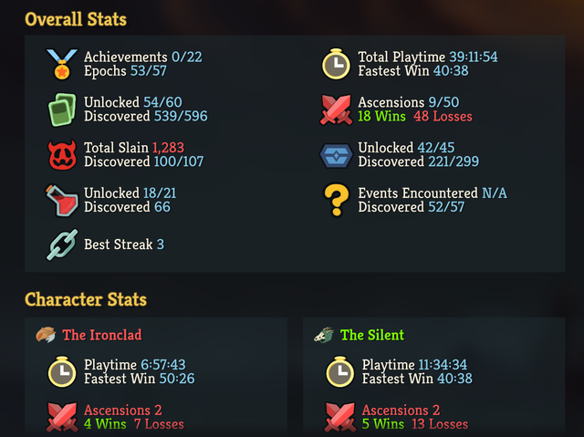</td>
    <td align="center" valign="middle">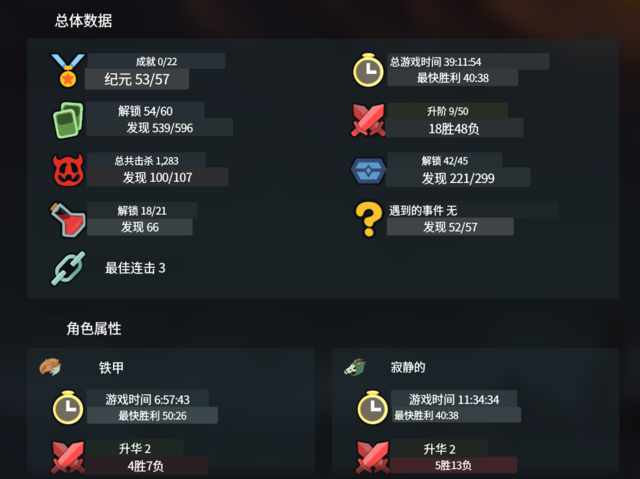</td>
  </tr>
  <tr><td colspan="2" align="center">状态界面：🇬🇧 英文 → 🇨🇳 中文<br><sub>Gemma 4 E2B（显卡）</sub></td></tr>
  <tr>
    <td align="center" valign="middle">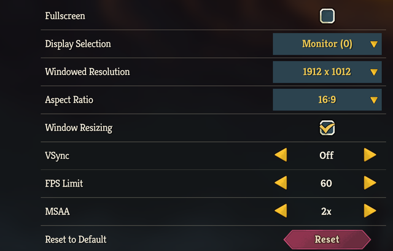</td>
    <td align="center" valign="middle">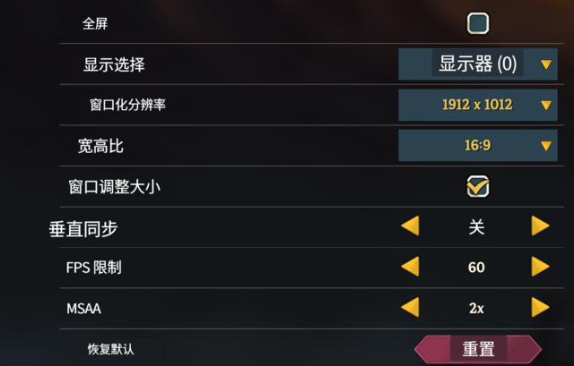</td>
  </tr>
  <tr><td colspan="2" align="center">菜单：🇬🇧 英文 → 🇨🇳 中文<br><sub>Gemma 4 E2B（显卡）</sub></td></tr>
  <tr>
    <td align="center" valign="middle">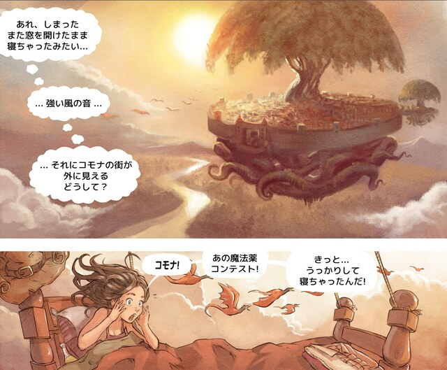</td>
    <td align="center" valign="middle">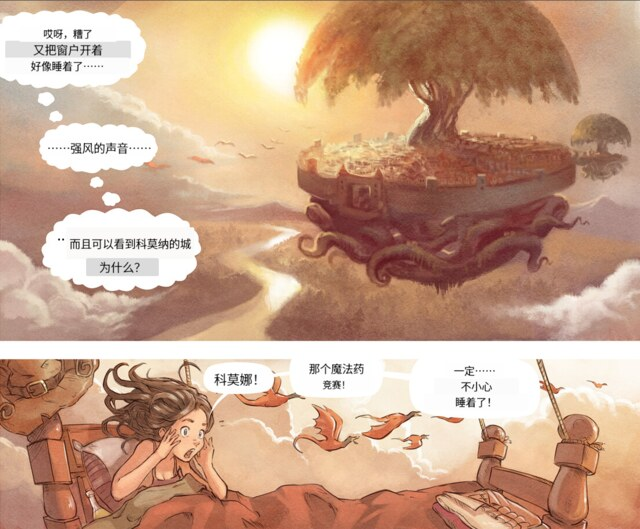</td>
  </tr>
  <tr><td colspan="2" align="center">漫画：🇯🇵 日文 → 🇨🇳 中文<br><sub>Gemma 4 E2B（显卡）。<a href="https://www.peppercarrot.com">Pepper&amp;Carrot</a>，作者 David Revoy，CC-BY 4.0</sub></td></tr>
  <tr>
    <td align="center" valign="middle"></td>
    <td align="center" valign="middle">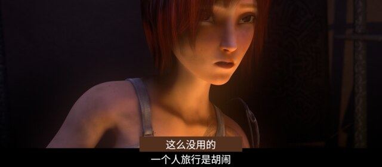</td>
  </tr>
  <tr><td colspan="2" align="center">播放中的视频：🇯🇵 日文字幕 → 🇨🇳 中文，约慢 1 秒<br><sub>Gemma 4 E2B（显卡）。<a href="https://durian.blender.org">Sintel</a> © Blender Foundation, CC-BY 3.0</sub></td></tr>
</table>

## 下载和安装

从[发布页面](https://github.com/malnon-labs/lenslate/releases/latest)下载 `lenslate-<版本>.tar.gz`（约 6 MB），然后：

```sh
tar xf lenslate-*.tar.gz && cd lenslate-*/
./install.sh
```

安装程序会从你的发行版软件源中补齐缺少的软件包（只有这时才需要输入密码），把 **lenslate** 加入应用菜单，并在 KDE 上设置快捷键。`./install.sh --uninstall` 可以卸载。
想用 git？`git clone https://github.com/malnon-labs/lenslate.git && cd lenslate && ./install.sh`。

校验下载：从同一个发布页面获取 `.sha256` 文件，在两个文件所在的文件夹中运行 `sha256sum -c lenslate-*.tar.gz.sha256`。

**即将推出：AppImage。** 一个无需安装的单文件版本，以及一个离线版本，内置识别模型和 🇯🇵→🇬🇧、🇨🇳→🇬🇧、🇬🇧→🇧🇷 翻译器。

**能在我的系统上运行吗？** lenslate 已在 **KDE Plasma 6（Wayland）** 和 **X11 桌面**（Linux Mint 22 Cinnamon）上测试。安装程序支持 Fedora、Arch、Debian 13+、Ubuntu 25.04+、openSUSE 和 Linux Mint 22。其他 Wayland 桌面（Hyprland、Sway、niri）应该可以使用，但只做过部分测试；GNOME（Wayland）暂时无法显示覆盖层。详见 [docs/CAPTURE.md](docs/CAPTURE.md)（英文）。

## 第一次翻译

1. 从应用菜单启动 **lenslate**。第一次启动时，设置窗口会询问你能读哪些语言、想要翻译成哪种语言，为你的电脑推荐一个预设，并在下载任何东西之前列出每个下载及其大小。
2. 打开游戏，然后在 lenslate 窗口（或托盘图标菜单）中点击 **Pick area…**，框选你想翻译的文字。
3. 译文会显示在原文上方。勾选 **Keep translating automatically** 让它在游戏过程中持续更新，用 **Show / hide** 隐藏或显示译文。

<sub>这四个操作在游戏中也有快捷键（Ctrl+Alt+Z、X、C 和 V）。KDE 上会自动设置；其他桌面请参阅[完整指南中的快捷键部分](docs/USAGE.md#hotkeys-and-commands)（英文）。</sub>

## 界面一览

<table>
  <tr>
    <td align="center">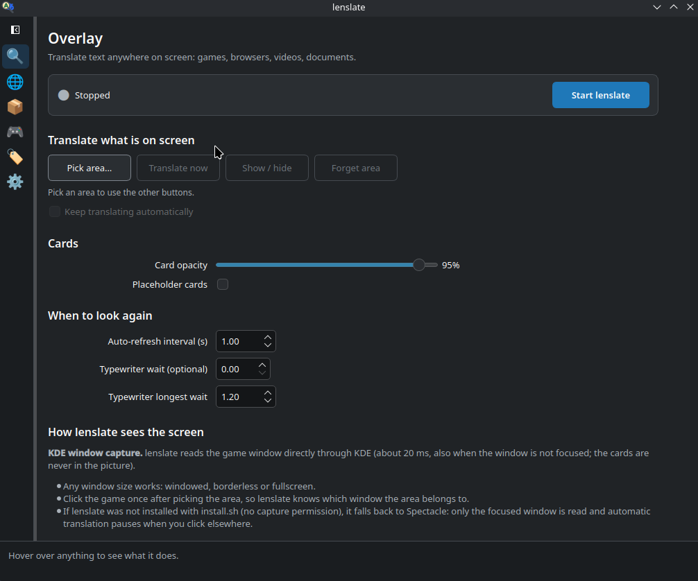<br>选择区域、翻译、显示或隐藏：都有按钮</td>
    <td align="center">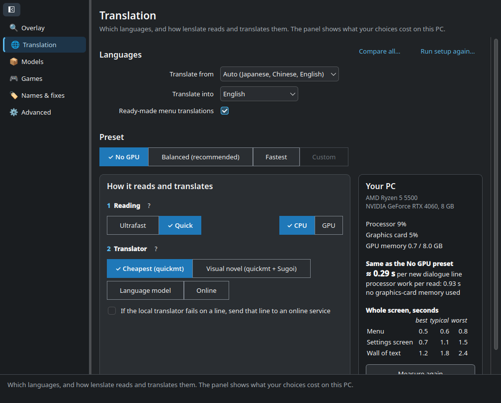<br>适合有显卡和没有显卡电脑的预设</td>
  </tr>
  <tr>
    <td align="center">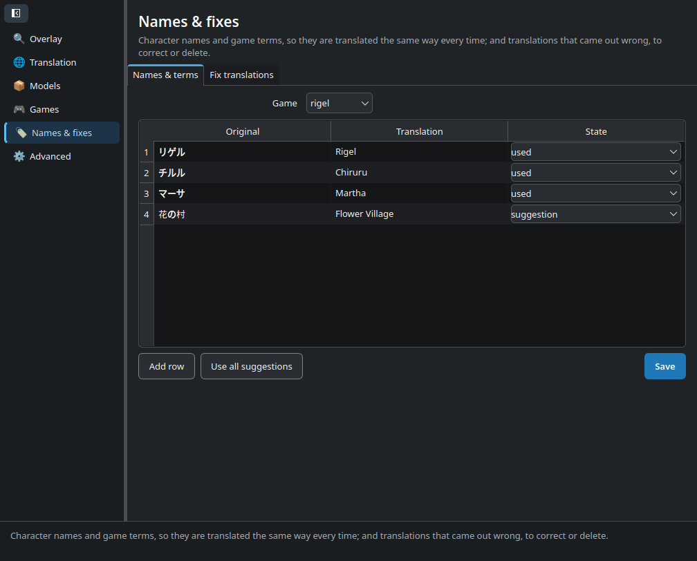<br>角色名每次都以同样的方式翻译</td>
    <td align="center">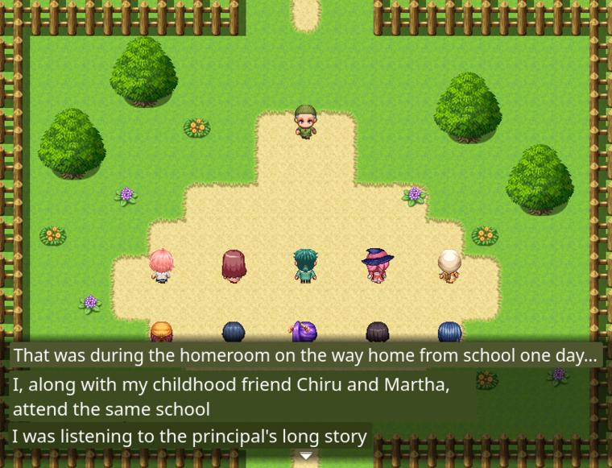<br>地图上的剧情文字，原地翻译</td>
  </tr>
</table>

完整功能列表见 [docs/FEATURES.md](docs/FEATURES.md)（英文）。lenslate 的界面目前只有英文，中文界面已在计划中。

<sub>截图中的游戏名称和美术归其所有者所有，仅用于展示 lenslate：Risk of Rain 2（Hopoo Games / Gearbox）、Slay the Spire 2（Mega Crit）和
<a href="https://www.freem.ne.jp/win/game/35454">リゲルと3つの魔魂石</a>（作者 Chie），其使用条款允许为介绍游戏而使用截图。漫画：Pepper&amp;Carrot，作者 David Revoy（CC-BY 4.0）。影片：Sintel © Blender Foundation（CC-BY 3.0）。</sub>

## lenslate 还是游戏文件翻译工具？

[RuneTranslate](https://runetranslate.itch.io/runetranslate) 或 Translator++ 这类工具通过修改游戏文件来翻译：翻译在游玩之前一次完成。如果你的游戏引擎受支持，那样体验更流畅，因为游玩时不需要额外运行任何东西。

lenslate 完全不修改游戏。当引擎不受支持、你不能或不想修改游戏文件，或者要翻译的不是游戏时，就用 lenslate。代价是游玩时识别和翻译会占用 CPU 或显卡。

对于少数引擎，lenslate 也可以反过来工作：可选的**游戏钩子**可以在 **Unity**（通过 XUnity.AutoTranslator）、**RPG Maker MV / MZ** 和 **Ren'Py 7 / 8** 游戏*内部*翻译。RPG Maker 游戏甚至可以提前翻译，游玩时不用运行任何东西。钩子会备份它修改的每个文件，`lenslate hook remove` 可以还原。详见[游戏钩子](docs/USAGE.md#hooks-translation-inside-the-game-no-screen-reading)（英文）。

## 须知

- **首次启动需要下载。** 识别模型和翻译器只下载一次（一个语言对约 1 GB）。
- **装饰性文字**（logo、发光或描边的标题）常常识别错误。普通的菜单和对话文字识别良好。
- **部分 AI 模型仅限个人使用。** PLaMo 和 Sugoi 可免费用于个人和非商业用途；lenslate 在下载模型前总会说明其许可证。所有许可证见 [NOTICE.md](NOTICE.md)（英文）。
- **0.2 将带来：** lenslate 界面的 🇧🇷 葡萄牙文、🇨🇳 中文、🇯🇵 日文、🇰🇷 韩文和 🇷🇺 俄文版本；AppImage（含离线版）；可在 lenslate 内修改的键盘快捷键。**计划中：** 直接在浏览器中翻译图片。

## 反馈问题

发现了 bug？请[提交 issue](https://github.com/malnon-labs/lenslate/issues/new/choose)，并写明你的 Linux 发行版和桌面环境、lenslate 版本（`lenslate --version`）以及你看到的情况。调试录制最有帮助：[如何录制](docs/USAGE.md#troubleshooting--contributing)（英文）。录制中包含游戏截图，附上之前请先检查一遍。更多内容见 [CONTRIBUTING.md](CONTRIBUTING.md)，安全问题见 [SECURITY.md](SECURITY.md)（英文）。可以用中文提交。

## 更多（英文）

- [使用 lenslate](docs/USAGE.md)：所有命令、设置、翻译器、预设和游戏钩子。
- [功能](docs/FEATURES.md)：lenslate 的全部功能。
- [隐私](docs/PRIVACY.md)：哪些内容会联网，哪些留在你的电脑上。无账号，无遥测。
- [各桌面的屏幕捕获](docs/CAPTURE.md)：在 KDE、X11、Hyprland、Sway、GNOME 上分享什么、能期待什么。
- [lenslate 下载内容的许可证](NOTICE.md)。

## 许可证

[GPL-3.0-or-later](LICENSE)。

<sub>这是 [README.md](README.md) 的翻译，可能有不自然的地方。欢迎母语使用者通过 issue 或 pull request 改进。</sub>
