# What lenslate does

The [README](../README.md) is the short tour. This is the full list. How to use each feature is in
[USAGE.md](USAGE.md).

## In pictures

Real screenshots taken with lenslate 0.1 on Linux (KDE Plasma, Wayland). The left picture is the original, the right
one is the same screen with lenslate's cards on top.

| Original | With lenslate |
| :---: | :---: |
| 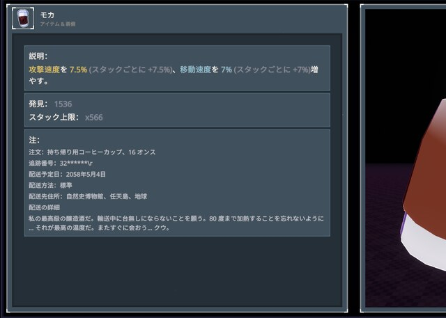 | 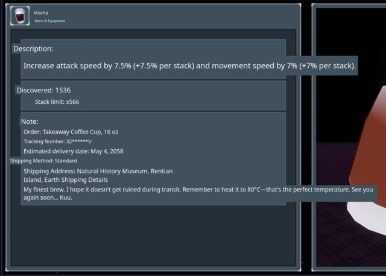 |
| *Item page with a long description: 🇯🇵 → 🇬🇧, PLaMo 3 Translate* | |
| 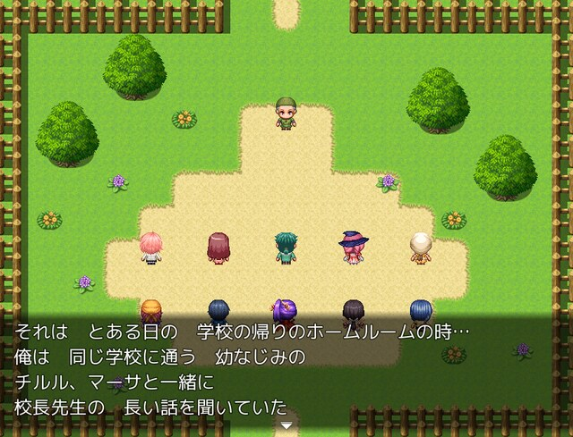 | 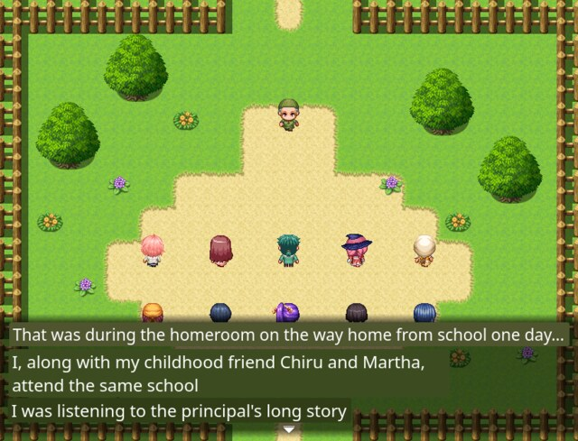 |
| *Narration over the map: 🇯🇵 → 🇬🇧, Gemma 4 E2B* | |
| 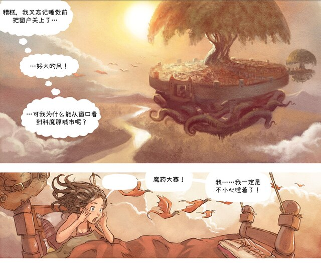 |  |
| *Comic: 🇨🇳 → 🇬🇧, Gemma 4 E2B* | |
| 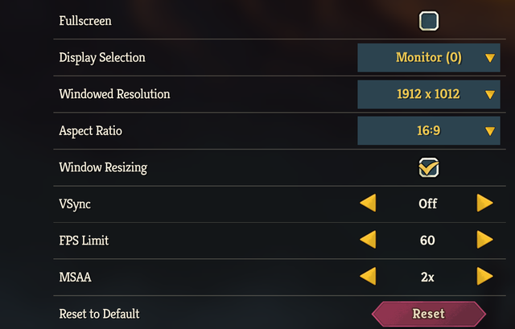 | 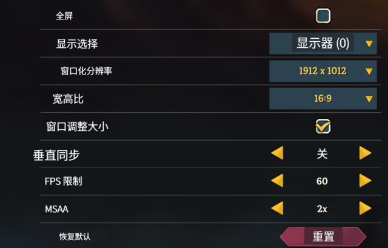 |
| *Menu: 🇬🇧 → 🇨🇳, Gemma 4 E2B* | |
| 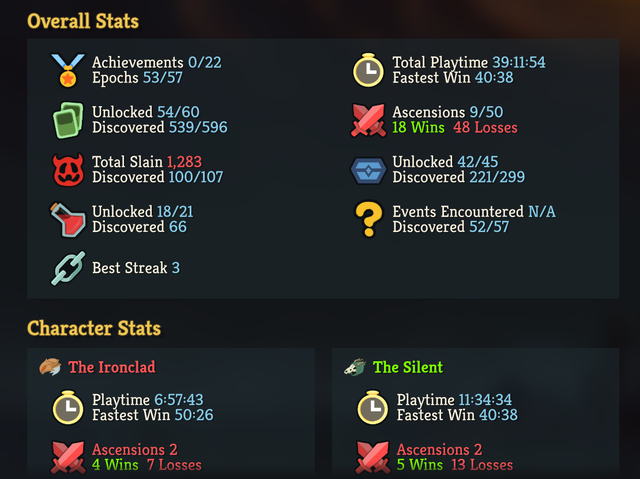 | 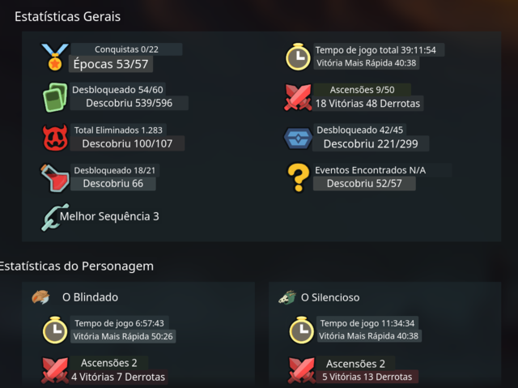 |
| *Status screen: 🇬🇧 → 🇧🇷, Gemma 4 E2B* | |
| 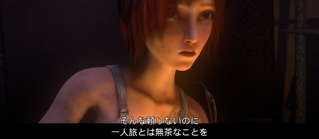 | 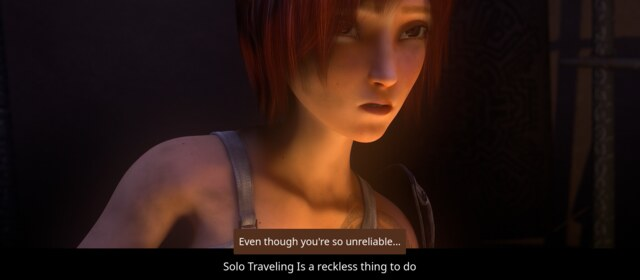 |
| *Video with subtitles in the picture: 🇯🇵 → 🇬🇧, PLaMo 3 Translate* | |

**While a video plays.** Three moments from Sintel playing with Japanese subtitles and auto refresh on: each new
subtitle got its English card about 1 second after it appeared (0.6–1.0 s per read on an RTX 4060), and old cards
went away when the subtitle changed.

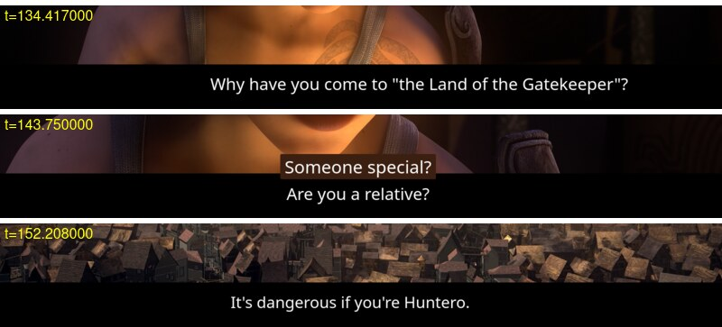

What these pictures also show, honestly: text that wraps over several lines in a speech bubble or a centred panel
is translated line by line, and every card keeps the height of its original line, so cards differ in size.
Both are on the list to improve (docs/ROADMAP.md).

Game names and art belong to their owners and are shown only to illustrate lenslate: Risk of Rain 2
(Hopoo Games / Gearbox), Slay the Spire 2 (Mega Crit), リゲルと3つの魔魂石 (Chie, <a href="https://www.freem.ne.jp/win/game/35454">Freem</a>).
Pepper&amp;Carrot by David Revoy (CC-BY 4.0, <a href="https://www.peppercarrot.com">peppercarrot.com</a>). Sintel © Blender
Foundation (CC-BY 3.0, <a href="https://durian.blender.org">durian.blender.org</a>), Japanese subtitles from the Durian project.

## Translating the screen
- **Cards over the text.** Each piece of text gets a card with its translation, in the same place and about
  the same size. The cards are click-through, so the game still gets your mouse.
- **Pick an area once.** Drag a box over the text and lenslate watches that area. If the game window moves or
  is resized, the area moves with it.
- **Auto refresh**, about once a second. Only the parts of the screen that changed are read again, and
  animated backgrounds and moving sprites are mostly ignored.
- **Instant for lines it has seen.** Every translation is cached, so menus you've opened before show up at once.
- **Typewriter text.** Dialogue that types out letter by letter keeps its card with "…" until the line is done.
- **Hide / show** with one key. Hiding also pauses auto refresh.
- **Card look:** solid or see-through background. Text that doesn't fit is wrapped or made smaller, and cards
  never cover each other.
- **Multiple monitors and display scales** (100 %, 125 %, 200 %…), on the same or different monitors.

## Reading text (OCR)
- **Reads 🇯🇵 Japanese, 🇨🇳 Chinese (Simplified and Traditional) and 🇬🇧 English** with one model, and 🇰🇷 **Korean**
  and 🇷🇺 **Russian** with their own readers.
- **Quick** reading on any processor, or on an NVIDIA graphics card for the lowest delay.
- **Ultrafast** reading for Japanese (meikiocr, trained on game text).
- **Repairs common misreads,** for example katakana read as look-alike kanji.

## Translating
- **Processor translators** (quickmt, OPUS): small (~0.4 GB each), fast, and need no graphics card.
- **AI translation models** on your graphics card, run by lenslate's built-in runner (NVIDIA, AMD and Intel
  through Vulkan). Gemma 4 E2B for any language pair, and PLaMo 3 Translate for the most natural Japanese →
  English dialogue. Ollama works too.
- **Visual novel mode:** Sugoi v4 for Japanese dialogue.
- **Online translators** (Google, Bing, Yandex, DeepL), off by default. Use one as your translator or only as
  a fallback.
- **Earlier lines as context** for the AI models, so "she" and "it" come out right.
- **Ready-made packs** of common menu and settings lines.
- **Into:** 🇬🇧 English, 🇨🇳 Chinese (Simplified), 🇪🇸 Spanish and 🇧🇷 Portuguese (Brazil). The AI models and online
  translators handle any pair; the processor translators cover 🇯🇵→🇬🇧, 🇨🇳→🇬🇧, 🇬🇧→🇨🇳, 🇬🇧→🇪🇸 and 🇬🇧→🇧🇷.

## Names and corrections
- **Character name lists** per game, filled from the game's files or while you play. New names are suggested
  for you to confirm.
- **Fix a translation once** and your version is used from then on.

## Inside the game (optional hooks)
- **RPG Maker MV / MZ:** a plugin that translates messages, choices, menus and items inside the game, and can
  translate the whole game ahead of time.
- **Ren'Py 7 / 8:** a script that translates dialogue and menus before they are shown.
- **Unity:** connects XUnity.AutoTranslator to lenslate.
- Every file a hook changes is backed up, and `lenslate hook remove` puts it back.

## Setup and settings
- **Setup window:** tick the languages you read, and only what they need is downloaded. Every download shows
  its size and licence first.
- **Presets** (No GPU, Balanced, Fastest) with a hardware check that suggests one for your PC.
- **Settings window and tray icon** (pick area, translate now, auto refresh and hide are buttons there too), plus a config file where every setting is explained.
- **Command line** for everything (`lenslate help`).
- **Hotkeys** set up on KDE, Cinnamon and GNOME. Lines to paste for Hyprland, Sway, i3, niri, Xfce and MATE.
- **Testbench:** try every preset on test screens or your own screenshots, with timings and a preview.
- **Debug recordings** for bug reports.

## Desktops (Linux first)
- **KDE Plasma 6 (Wayland):** the main platform. The cards sit above fullscreen games.
- **X11 desktops** (tested on Linux Mint Cinnamon).
- **Hyprland, Sway, niri:** through screen sharing. niri partly tested (nested in KDE); Hyprland and Sway not tried yet.
- **GNOME (Wayland):** not yet (no way to place the overlay there).
- Details: [CAPTURE.md](CAPTURE.md).
